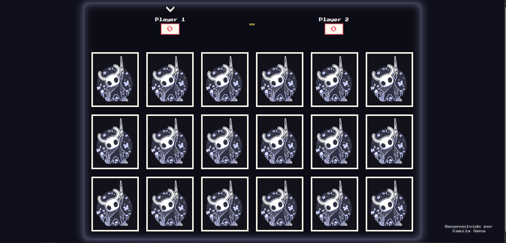

# 🎮 Hollow Knight Matching Game

Um jogo da memória temático baseado no universo de Hollow Knight - um dos jogos indie mais aclamados de todos os tempos.



## 📖 Sobre o Projeto

Este é um jogo da memória para dois jogadores onde cada um tenta encontrar pares de cartas com personagens de Hollow Knight. O jogo foi desenvolvido utilizando HTML, CSS e JavaScript puro, com uma interface responsiva e efeitos visuais inspirados na estética do jogo original.

## 🚀 Funcionalidades

- **Jogo para dois jogadores** - Alterne entre dois jogadores para encontrar pares de cartas
- **Cartas com personagens de Hollow Knight** - Inclui personagens icônicos como Knight, Hornet, Grimm e outros
- **Sistema de pontuação** - Acompanhe a pontuação de cada jogador
- **Indicador de turno** - Uma seta indica qual jogador deve jogar
- **Design temático** - Interface visual inspirada na estética de Hollow Knight
- **Responsivo** - Se adapta a diferentes tamanhos de tela
- **Efeitos visuais** - Animações e efeitos neon para uma experiência imersiva

## 🎮 Como Jogar

1. Clique no botão "Iniciar Jogo" na tela inicial
2. O Jogador 1 começa o jogo
3. Clique em duas cartas para revelá-las
4. Se as cartas formarem um par, o jogador ganha um ponto e continua jogando
5. Se as cartas forem diferentes, elas são viradas novamente e é a vez do outro jogador
6. O jogo continua até que todos os pares sejam encontrados
7. Vence o jogador que encontrar mais pares

## 🔧 Tecnologias Utilizadas

- **HTML5** - Estrutura da página
- **CSS3** - Estilização e animações
- **JavaScript** - Lógica do jogo e interatividade
- **Algoritmo Fisher-Yates** - Para embaralhar as cartas de forma eficiente

## 📋 Estrutura do Projeto

O projeto segue uma estrutura modular, com componentes reutilizáveis:

```
hollow-knight-matching-game/
│
├── main.js               # Ponto de entrada da aplicação
├── src/
│   ├── components/       # Componentes individuais reutilizáveis
│   │   ├── ArrowDown/    # Indicador de turno
│   │   ├── CardFrontBack/# Componente de carta (frente e verso)
│   │   ├── CardGame/     # Componente base para as cartas
│   │   ├── PlayerName/   # Nome do jogador
│   │   ├── PlayerScore/  # Pontuação do jogador
│   │   ├── VsPlayer/     # Elemento "VS" entre jogadores
│   │   └── images/       # Imagens dos personagens
│   │
│   ├── objects/          # Objetos complexos compostos por componentes
│   │   ├── BoardGame/    # Tabuleiro do jogo
│   │   └── ScoreBoard/   # Placar e informações dos jogadores
│   │
│   └── styles/           # Estilos CSS
│       ├── containers/   # Estilos para os contêineres
│       ├── components/   # Estilos para componentes específicos
│       ├── elements/     # Estilos para elementos básicos
│       ├── generic/      # Estilos genéricos (reset)
│       └── settings/     # Configurações (variáveis CSS)
```

## 💡 Recursos de Código Interessantes

### Embaralhamento de Cartas

O jogo utiliza o algoritmo Fisher-Yates para embaralhar as cartas de forma eficiente:

```javascript
const shuffleCards = (cardsArray) => {
  const shuffledCards = [...cardsArray];
  for (let i = shuffledCards.length - 1; i > 0; i--) {
    const j = Math.floor(Math.random() * (i + 1));
    [shuffledCards[i], shuffledCards[j]] = [shuffledCards[j], shuffledCards[i]];
  }
  return shuffledCards;
};
```

### Verificação de Pares

O sistema de verificação de pares compara os ícones das cartas selecionadas:

```javascript
// Verifica se as cartas têm o mesmo ícone
const firstCardIcon = $cardsActive[0]
  .querySelector(".card.-back")
  .getAttribute("data-icon");
const secondCardIcon = $cardsActive[1]
  .querySelector(".card.-back")
  .getAttribute("data-icon");

if (firstCardIcon === secondCardIcon) {
  // Se forem iguais, adiciona a classe -matched para mantê-las viradas
  $cardsActive.forEach((card) => {
    card.classList.add("-matched");
  });

  // Atualiza o contador de pares encontrados
  window.boardGame.matchedPairs++;

  // Adiciona ponto ao jogador atual
  window.boardGame.addPoint();

  // Verifica se o jogo acabou
  window.boardGame.checkEndGame();
}
```

## 🎨 Personalização

### Personagens

É possível personalizar os personagens do jogo modificando o arquivo `src/objects/BoardGame/data.js`:

```javascript
const cards = [
  // Personagens do jogo
  {
    icon: "knight",
    altIcon: "imagem do hollow",
  },
  // Adicione mais personagens aqui
];
```

## 🚀 Como Executar o Projeto

### Localmente

1. Clone o repositório:

```bash
git clone https://github.com/camilasena-a/hollow-knight-matching-game.git
cd hollow-knight-matching-game
```

2. Instale as dependências:

```bash
npm install
```

3. Execute o projeto em modo de desenvolvimento:

```bash
npm run dev
```

4. Abra o navegador em `http://localhost:5173`

### Deploy no GitHub Pages

1. Faça o build do projeto:

```bash
npm run build
```

2. Execute o deploy:

```bash
npm run deploy
```

O projeto será automaticamente publicado em: `https://camilasena-a.github.io/hollow-knight-matching-game/`

## 🔍 Próximos Passos

Algumas melhorias que podem ser implementadas no futuro:

- Adicionar efeitos sonoros do jogo original
- Implementar diferentes níveis de dificuldade
- Adicionar um modo de um jogador contra o computador
- Salvar histórico de pontuações
- Adicionar animações mais elaboradas
- Implementar sistema de ranking

## 📄 Licença

Este projeto está sob a licença MIT. Veja o arquivo LICENSE para mais detalhes.

## 🙏 Créditos

- Todos os personagens e elementos visuais pertencem a Team Cherry, criadores de Hollow Knight
- Desenvolvido por [Camila Sena](https://github.com/camilasena-a)

---

Jogue e divirta-se! 🕹️
